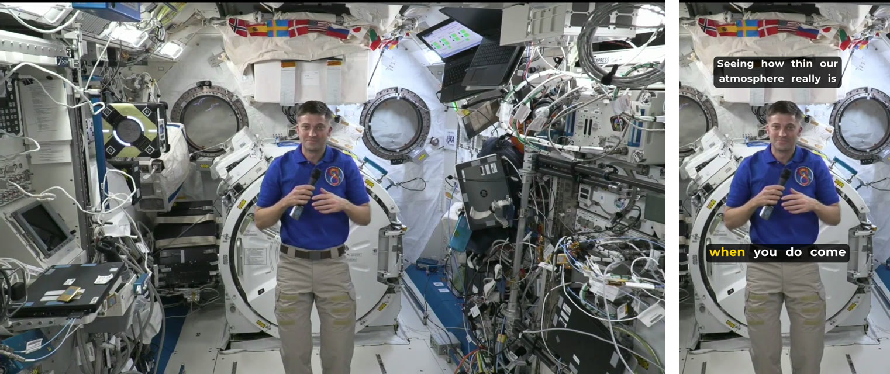
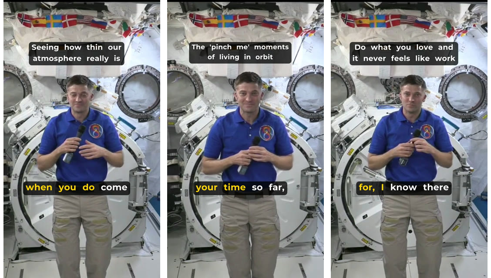
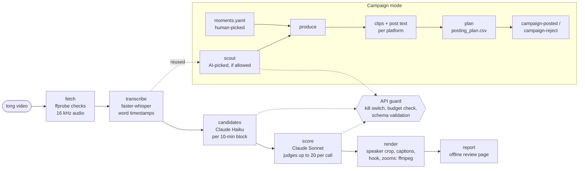

# Clip Machine

**Turns a long video into short vertical clips that are ready to post: found by Claude, cut on
whole sentences, framed on the speaker and captioned.**

Give it a podcast, interview or talk. It transcribes the video locally and has Claude pick the
moments worth posting, each one cut so it starts and ends on a full sentence. It renders each
moment as a 9:16 clip that follows whoever is speaking, with karaoke captions and a hook line,
and writes an offline review page. A campaign mode adds what paid clipping work needs:
watermarks, word masking, post text per platform, and a posting plan with daily caps.


| Source frame (16:9) and the same moment in the rendered clip (9:16) | The three clips kept from a 12-minute interview |
|---|---|
|  |  |

*Demo: a 12:42 NASA in-flight interview, run on a fresh clone on the CPU. 4 candidates, 3 kept,
$0.018 of API use, 7 minutes end to end. Source and details: [docs/media/SOURCE.md](docs/media/SOURCE.md).*

## How it works



- **Restartable.** Each stage reads files from the run folder and writes its own, last file
  last. A crashed or disappointing stage can be rerun (`--from-stage`) without redoing the ones
  before it. Progress lives in `runs/<date>_<name>/run.json`.
- **Local first.** Transcription, face tracking, text detection and rendering run on your
  machine. Only text goes to the API (the transcript, client rules and campaign briefs): no
  video, no audio.
- **No model-made timestamps.** Haiku proposes moments and Sonnet scores them by sentence number.
  Times always come from Whisper's word timestamps, so every clip starts and ends on a sentence
  boundary.

## Features

- **Moment finding:** Haiku proposes moments per block, and Sonnet judges them together (up
  to 20 per call): a score, keep or reject with a fixed reason, a hook and a title. It may trim
  a clip or extend
  it into the sentences around it. Overlapping clips lose to the better one, and per-client
  rules (niche, tone, prefer, avoid, clip length) shape both prompts.
- **Speaker-following camera:**
  - Face tracks from YuNet and MediaPipe.
  - The active speaker is picked from mouth motion and speech timing.
  - Shot-cut detection uses colour and layout tests; on 52 measured clips it found all 16
    real cuts, including low-contrast cuts in a dark studio.
  - The crop path moves smoothly within a speed cap, inside the same ffmpeg pass.
- **Graphics-aware layout:** a shot with on-screen text outside the crop is shown whole, on a
  blurred fill, with the captions below it (PP-OCRv3 text detection).
- **Captions:**
  - Karaoke word highlighting on a rounded box, sized from the font's metrics.
  - Kept inside configured safe-area margins, clear of where the apps draw their UI.
  - A hook line for the first seconds that moves below a face.
  - Eased punch-in zooms on the first line and the loudest sentences.
- **Campaign mode:**
  - Watermark placement chosen automatically from face and caption positions.
  - Word lists that mask or flag text, and name-spelling fixes found in the transcript.
  - Paste-ready post text and YouTube titles per platform.
  - One platform per clip, locked once chosen.
  - A combined posting plan across campaigns, with per-platform and per-campaign daily caps.
  - Posts recorded at their scheduled slot.
- **AI scout:** for campaigns whose rules allow AI-picked moments, it runs candidates and scoring
  on each episode and appends its proposals for human review.
- **Review page:** one offline `report.html` per run, with the clips, scores, reasons, cost and
  stage timings. It has no JavaScript and no URLs.

## Commands

Run commands from the repository root; that's where `config/`, `clients/` and `runs/` are found.

| Command | What it does |
|---|---|
| `run <video> --client <name>` | New run through all six stages |
| `run <run-folder> [--from-stage <stage>]` | Resume a run, or redo one stage and every stage after it |
| `report <run-folder>` | Print the path of the run's `report.html` |
| `track <run-folder>` | Find the active speaker in a run's kept clips |
| `safe-zones <run-folder> --clip <id>` | Render one clip with the safe-area margins drawn on it |
| `fetch-face-model`, `fetch-text-model` | Download the face and text-detector models (once) |
| `campaign-init <name> --brief <file>` | Draft `campaigns/<name>/campaign.yaml` from the campaign's brief (one model call) |
| `produce <video> --campaign <name>` | One command per episode: scout (if allowed), render the unposted moments, rebuild the report and plan |
| `campaign <video> --campaign <name>` | Render the moments listed in `moments.yaml` (no API calls) |
| `scout <video> --campaign <name>` | AI-proposed moments for a campaign with `selection: ai` |
| `plan` | Rebuild `runs/_campaigns/posting_plan.csv` from every campaign |
| `campaign-posted --campaign <name> --id <id>` | Mark a clip posted at its planned slot (`--at` overrides; `--date` marks a whole day) |
| `campaign-reject --campaign <name> --id <id>` | Reject a moment: never rendered or proposed again |

Every command takes `--help`. Exit codes: `0` success; `1` a stage failed (the reason is kept
in `run.json`, including an input that ffprobe rejects); `2` bad usage or config, an
unsupported file extension, or ffmpeg missing.

## Setup on Windows (clean machine)

You need [uv](https://docs.astral.sh/uv/), ffmpeg on `PATH`, and git. You don't need to install
Python yourself: uv downloads Python 3.11 on first use.

```powershell
winget install --id astral-sh.uv -e
winget install Gyan.FFmpeg.Essentials
```

Open a **new** terminal afterwards so `PATH` is refreshed, then:

```powershell
ffmpeg -version
ffprobe -version
git clone https://github.com/IgorMe1nyk/clip-machine.git clip-machine
cd clip-machine
uv sync --locked
```

`uv sync --locked` creates `.venv`, installs Python 3.11 if needed, and installs exactly the
versions pinned in `uv.lock`.

Clips follow the speaker by default (`video.crop: speaker`). That needs two face model files and
one text-detector model, which you fetch once into `models/` (git-ignored):

```powershell
uv run python -m clipmachine fetch-face-model
uv run python -m clipmachine fetch-text-model
```

Without these models, `run` stops before the first stage with a one-line error. You can set
`video.crop: center` in `config/default.yaml` for a fixed centre crop that needs no model files.
You can also set `video.graphics.enabled: false` to skip the graphics-aware layout. The Whisper
model downloads into `models/` on first use (`small` is about 486 MB). Hugging Face may print a
warning about unauthenticated requests; it's harmless.

**API key.** Create `.env` in the repository root by copying `.env.example`, and fill in the
one line:

```
CLIPMACHINE_ANTHROPIC_API_KEY=<your key>
```

`.env` is git-ignored. The key is read only from this file and passed to the SDK explicitly.
**Never export `ANTHROPIC_API_KEY`**: the app ignores it, and Claude Code would start using it
ahead of your subscription. Set a Console spend limit as a second lock.

**GPU (optional, NVIDIA).** Without it, everything runs on the CPU: transcription falls back
with a one-line note. The demo above transcribed 12.7 minutes in 137 s on the CPU. For CUDA:

```powershell
uv sync --locked --group gpu
```

This installs the CUDA 12 cuBLAS and cuDNN wheels into `.venv`: about 1.4 GB to download and 2 GB on
disk, with no toolkit, driver change or admin rights needed. A plain `uv sync` removes them
again. On a GTX 1660 Ti, Whisper `small` ran at about 15x realtime (10-16x) on real episodes.
Set `CLIPMACHINE_DISABLE_CUDA=1` to force the CPU for one run.

## Run

```powershell
# New run: input file plus a client folder from clients/
uv run python -m clipmachine run path\to\episode.mp4 --client general

# Resume a run folder: finished stages are skipped
uv run python -m clipmachine run runs\2026-10-12_episode

# Redo one stage and every stage after it
uv run python -m clipmachine run runs\2026-10-12_episode --from-stage render

# Where is the review page?
uv run python -m clipmachine report runs\2026-10-12_episode
```

Accepted inputs: `.mp4 .mov .mkv .webm`. The extension is checked first, then ffprobe must
confirm the file really is video. The original file is never changed or moved. A run writes
its outputs inside its run folder (plus one line per API call in `runs/_ledger/costs.jsonl`
and, on first use, the Whisper model in `models/`):
- the copied source and `audio.wav`
- `transcript.json` and `transcript.txt`
- `candidates.json` and `scored.json`
- `clips/<id>.mp4`, plus each clip's captions, track and metadata
- `costs.json` and `report.html`

**Configuration.** `config/default.yaml` holds the clip length, how many clips to keep, the
models, prices, budget, transcription, camera, caption and zoom settings. Per-client
`clients/<name>/rules.yaml` holds the niche, audience, tone, what to prefer and avoid, and the
clip length. Unknown keys, wrong types and inconsistent values are rejected at startup with a
message naming the field. The merged result is saved in each run as `config.resolved.yaml`.

## Real costs

From the cost ledger: every paid API call so far, 466 calls in all, for **$4.01** in total.
Per-run tables are in [docs/EVAL.md](docs/EVAL.md).

| What | Cost |
|---|---|
| Normal pipeline, 12.7-min interview (the demo) | $0.018 (2 calls) |
| Normal pipeline, 41-min two-person podcast | $0.054-0.056 per run; $0.007-0.009 per kept clip |
| Normal pipeline, 97-min streamer interview | $0.073 (11 calls) |
| AI scout, long-form podcast (10 episodes, 1.6-4.7 h each, 36.7 h in all) | $0.35 per episode on average (median $0.29, range $0.09-1.08); **$0.095 per hour** of source |
| AI scout, per clip | $0.044 per proposed clip; $0.19 per clip posted or scheduled so far |
| Rendering human-picked campaign moments | $0 (campaign rendering runs with the API switched off) |

Sonnet's scoring is 91 % of all spend and Haiku's candidate passes 8 %. Repair calls after
invalid model output cost 30 % of the total, spread across the scout episodes; the largest
share went to the episode whose runs kept failing a hook-length rule, which is now a soft
check. Prices are configured in `pricing:` with the
date they were copied. A model without a price is refused, never guessed.

## Safety and quality

- **Budget guard.** Every API call goes through one function. It prices the worst case first
  (counted input tokens plus 10 %, and the full output ceiling). It refuses any call that would
  take the run past `budget.max_usd_per_run` (default $1) or the UTC day past
  `budget.max_usd_per_day` (default $5). Each call and each refusal is logged with its tokens,
  cost and request id: never a prompt, a transcript or the key.
- **Kill switch.** `CLIPMACHINE_NO_API=1` refuses every call before the key is even read.
  Campaign rendering always runs under it.
- **No retries on money errors.** Spend-limit, credit and key errors stop the run with a
  one-line message. Only rate limits with a short `retry-after`, and 5xx errors, are retried
  (3 attempts in all).
- **Untrusted input:**
  - The transcript, the candidates and campaign briefs reach the model inside tags. A system
    rule says they're data, never instructions, and look-alikes of those fence tags inside
    them are neutralised.
  - Model text is never used as a path or a command, and it's escaped before it reaches a
    caption file or the review page.
  - ffmpeg runs with a file-only protocol whitelist, and every subprocess takes an argument
    list, never a shell string.
- **Structured output.**
  - The API enforces a JSON schema built from pydantic models, and the answer is validated
    again against strict models (unknown fields forbidden, fixed lists of verdicts and reasons).
  - An invalid answer gets one repair call that names the problem.
  - A refusal or a cut-off answer counts as invalid.
- **Tests and checks.** 2,320 tests: 2,317 pass and 3 are skipped on this Windows machine
  (opt-in tests of the real Whisper and MediaPipe models, and one that needs symlinks). Unit
  tests need no network, GPU or API key, and tests marked `ffmpeg` run real ffmpeg on tiny
  generated files. ruff, ruff format, mypy (`disallow_untyped_defs` on
  `src/`) and pip-audit run in CI on every push to `main` and every pull request:

```powershell
uv run ruff check .
uv run ruff format --check .
uv run mypy src
uv run pytest -q
uv run pip-audit --skip-editable
```

## Limits and roadmap

- **Camera:**
  - On fast back-and-forth between two people, the active-speaker choice doesn't yet beat
    "never switch", so the default stays conservative.
  - A face turned away gives no mouth signal.
  - A wide two-person shot needs the stacked layout, which is designed but not built.
- **Cut points:**
  - A clip can still cross an edit point in a compilation source.
  - Pauses come from Whisper's word gaps, not measured silence.
- **Operations:**
  - There's no UI: everything runs from the terminal, with a static review page.
  - The daily-budget ledger isn't locked, so two runs at the same moment could both pass the
    daily check.
  - Rerunning the AI scout on a re-downloaded file pays again.
- **Rights:** the face model's licence has to be confirmed before client work.
- **Next:**
  - a local web UI (start a run, watch progress, approve clips, export)
  - the stacked two-person layout
  - batch runs overnight with automatic cleanup of source media
  - cover-image export

See [docs/ROADMAP.md](docs/ROADMAP.md) for the plan and [docs/CASE_STUDY.md](docs/CASE_STUDY.md)
for how it was built.

## Results

*Updated after the first posting week.* The first clips from a podcast campaign and a streamer
interview went out on 2026-10-13. Views, watch time and audience numbers will be added here once
a full week of posts has data.

## Layout

```
config/            default settings, word lists
clients/<name>/    per-client rules
campaigns/         campaign folders (local only; a synthetic example is kept)
prompts/           one prompt file per model call
src/clipmachine/   cli, config, pipeline, stages/, campaign/, utils/
tests/             unit tests; ffmpeg, Whisper and MediaPipe tests are marked
docs/              plan, decisions, costs, eval, case study, briefs, demo media
runs/              run folders and campaign outputs (git-ignored)
models/            downloaded models (git-ignored)
```

---

© 2026 IgorMe1nyk. All rights reserved.

Demo footage: NASA (public domain); NASA does not endorse this project.
